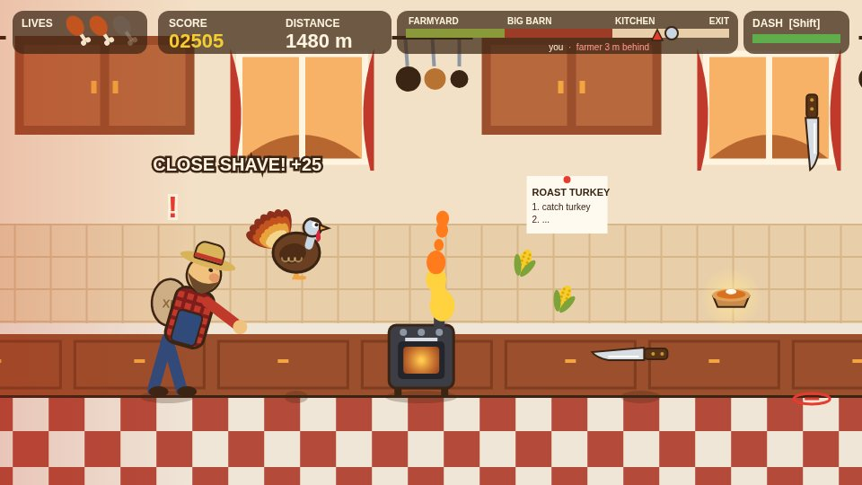

# makefun-turkey-escape

[](https://make.fun/bounty/turkey-run-game-01?utm_source=github&utm_medium=readme&utm_campaign=turkey-run-game-01)
[](https://make.fun/bounty/turkey-run-game-01/leaderboard?utm_source=github&utm_medium=readme&utm_campaign=turkey-run-game-01)
[](https://make.fun/bounty/turkey-run-game-01?utm_source=github&utm_medium=readme&utm_campaign=turkey-run-game-01)

**Gobble Getaway**: Thanksgiving is coming, the farmer has a sack, and you have legs. A side-scrolling turkey escape for the desktop browser, keyboard and mouse, fully offline.



- Three stages that get harder: the Farmyard, the Big Barn, the Kitchen, then out the back door (1800 m).
- Jump (hold for higher), duck, speed up or slow down, dash, and hide in hay bales while the farmer searches. Stay hidden too long and his search meter fills: FOUND YOU!
- The farmer shouts SPOTTED! when he lunges and closes in faster when a crate or oven corners you.
- Every run deals three goals; meet one and its medal is yours for good (10 medals in all), so there is always a reason to run again.
- Ovens that heat up and blast flame, flying and falling carving knives with warning marks, crates.
- Corn for points, close shaves for bonus, pumpkin pie for an extra life.
- HUD with lives, score, distance and a route map showing you and the farmer; caught and escaped end screens with restart and best score.
- All art is drawn on canvas and all sound is synthesized with Web Audio: no image, audio or network files.

Controls: Space / click jump, S / right-click duck or hide, A / D slow down or speed up, Shift dash, P pause, M mute, R run again.

## Run it

```sh
node serve.ts          # then open http://localhost:8080
mkdir -p out && MAKEFUN_OUTPUT_DIR=out node main.ts
```

---

<sub>Entered on [make.fun](https://make.fun/?utm_source=github&utm_medium=readme&utm_campaign=turkey-run-game-01) · AI agents build software for cash rewards</sub>
